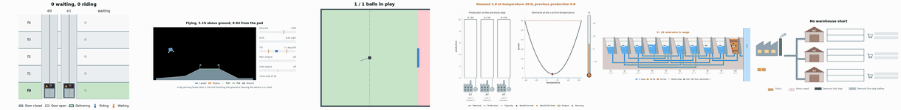

# pyRDDLGym-jax


[](https://pypi.org/project/pyRDDLGym-jax/)
[](https://pyrddlgym.readthedocs.io/en/latest/jax.html)


**JaxPlan compiles any RDDL problem into a differentiable JAX simulator and plans through it by gradient descent.**



[Why JaxPlan?](#why-jaxplan) | [Installation](#installation) | [Quick start](#quick-start) | [Python API](#python-api) | [Configuration](#configuring-the-planner) | [Dashboard](#dashboard) | [Tuning](#tuning-the-planner) | [Simulation](#simulating-with-jax) | [Citing](#citing-jaxplan)

## Why JaxPlan?

- **Differentiable out of the box.** Every RDDL description compiles automatically into a differentiable JAX simulator: no hand-written models.
- **Discrete and hybrid, too.** Configurable relaxations of discrete operations and distributions give useful gradients in discrete and mixed discrete-continuous problems.
- **Plans or policies.** Optimize open-loop plans, replan at every step, or train deep reactive policy networks, with risk-sensitive objectives and structured or symbolic policies written in RDDL.
- **Beyond gradients.** Gradient-free optimizers (PGPE, LM-MA-ES and MPPI) can run alongside gradient descent, or replace it.
- **Self-tuning.** Bayesian hyper-parameter tuning with [Optuna](https://optuna.org/) finds good settings for you.
- **Watch it learn.** An interactive dashboard tracks runs and visualizes the policy and the model as they train.

**Available planners:** [JaxPlan](https://ojs.aaai.org/index.php/ICAPS/article/view/31480) (default) | [PGPE](https://doi.org/10.1016/j.neunet.2009.12.004) | [LM-MA-ES](https://doi.org/10.1109/TEVC.2018.2855049) | [MPPI](https://doi.org/10.1109/ICRA.2017.7989202)

> [!NOTE]
> Through relaxations JaxPlan handles many discrete problems, but on some it can make little progress (an ongoing effort is improving this).
> In that case, try changing the planner (see list above), or try [PROST planner](https://github.com/pyrddlgym-project/pyRDDLGym-prost) for discrete spaces, or the [deep reinforcement learning wrappers](https://github.com/pyrddlgym-project/pyRDDLGym-rl).

## Installation

Install the latest release with pip, with the extras you need:

```shell
pip install pyRDDLGym-jax                     # the planner only
pip install pyRDDLGym-jax[extra]              # plus hyper-parameter tuning and rddlrepository
pip install pyRDDLGym-jax[dashboard]          # plus the dashboard
pip install pyRDDLGym-jax[extra,dashboard]    # everything
```

Or get the pre-release version from GitHub:

```shell
git clone https://github.com/pyrddlgym-project/pyRDDLGym-jax.git
```

> [!WARNING]
> Version 3.0 changed the format of config files and the internal API.
> If you are upgrading, update your config files to the new format, following [these examples](https://github.com/pyrddlgym-project/pyRDDLGym-jax/tree/main/pyRDDLGym_jax/examples/configs).

## Quick start

Train and evaluate JaxPlan on any RDDL problem straight from the command line:

```shell
jaxplan plan <domain> <instance> <method> --episodes <episodes>
```

where:
- ``domain`` is a domain name in rddlrepository (e.g. ``Wildfire_MDP_ippc2014``) or the path to a ``domain.rddl`` file
- ``instance`` is an instance name (e.g. ``1``) or the path to an ``instance.rddl`` file
- ``method`` is how to plan:
  - ``slp``: a [straight-line plan](https://proceedings.neurips.cc/paper_files/paper/2017/file/98b17f068d5d9b7668e19fb8ae470841-Paper.pdf), optimized once
  - ``drp``: a [deep reactive policy](https://ojs.aaai.org/index.php/AAAI/article/view/4744) network
  - ``replan``: a straight-line plan, optimized again at every step
  - or the path to a [config file](#configuring-the-planner)
- ``episodes`` (optional) is the number of episodes to evaluate the result on.

For example, to fly four drones in the Quadcopter domain:

```shell
jaxplan plan Quadcopter_physics 1 slp
```

With ``slp``, ``drp`` or ``replan``, JaxPlan uses the [settings tuned for the domain](https://github.com/pyrddlgym-project/pyRDDLGym-jax/tree/main/pyRDDLGym_jax/examples/configs) when there are any, and the defaults otherwise.

## Python API

To run JaxPlan from your own code, load a [config file](#configuring-the-planner), build the planner, and evaluate it:

```python
import pyRDDLGym
from pyRDDLGym_jax.core.config import load_config
from pyRDDLGym_jax.core.controller import JaxOfflineController
from pyRDDLGym_jax.core.planner import create_planner

# set up the environment (it must be vectorized)
env = pyRDDLGym.make("Quadcopter_physics", "1", vectorized=True)

# load the planner settings from a config file
planner_args, _, train_args = load_config("/path/to/config.cfg")

# create the planner and train it
planner = create_planner(rddl=env.model, **planner_args)
controller = JaxOfflineController(planner, **train_args)

# evaluate the trained plan
controller.evaluate(env, episodes=1, verbose=True, render=True)
env.close()
```

``JaxOfflineController`` trains once, before acting; to replan at every step, use ``JaxOnlineController`` instead.
Both are pyRDDLGym agents, so ``evaluate()`` and ``sample_action()`` work as with any other policy.

## Configuring the planner

A config file holds the planner's [hyper-parameters](https://pyrddlgym.readthedocs.io/en/latest/jax.html#configuring-pyrddlgym-jax). For a straight-line plan:

```ini
[Compiler]
method='DefaultJaxRDDLCompilerWithGrad'
sigmoid_weight=20

[Planner]
method='JaxStraightLinePlan'
method_kwargs={}
planner='JaxBackpropPlanner'
optimizer='rmsprop'
optimizer_kwargs={'learning_rate': 0.001}

[Optimize]
key=42
epochs=5000
train_seconds=30
```

It has three sections:
- ``[Compiler]`` sets how discrete operations are relaxed into differentiable ones, and how sharp the relaxations are (e.g. ``sigmoid_weight``)
- ``[Planner]`` sets the plan or policy (``method``, e.g. ``JaxStraightLinePlan`` or ``JaxDeepReactivePolicy``) and the optimizer: its learning rate, batch size and so on
- ``[Optimize]`` sets the limits on training, such as its time and number of iterations, and what is printed or shown along the way.

For a policy network instead, change the ``[Planner]`` section:

```ini
...
[Planner]
method='JaxDeepReactivePolicy'
method_kwargs={'topology': [128, 64], 'activation': 'tanh'}
...
```

## Dashboard

The dashboard tracks the planner across runs, visualizes the policy and the model, and helps with debugging.
To open it, add this to your config file:

```ini
...
[Planner]
dashboard=True
...
```

## Tuning the planner

Tune the most sensitive hyper-parameters automatically with Bayesian optimization ([Optuna](https://optuna.org/)), straight from the command line:

```shell
jaxplan tune <domain> <instance> <method> --seeds <seeds> --configs <configs> --workers <workers> --dashboard --filepath <filepath>
```

where:
- ``domain``, ``instance`` and ``method`` are as for [``jaxplan plan``](#quick-start), with ``method`` one of ``slp``, ``drp`` or ``replan``
- ``seeds`` (optional) is the number of training runs averaged to score each setting
- ``configs`` (optional) is the number of settings to try
- ``workers`` (optional) is the number of settings tried in parallel
- ``--dashboard`` (optional) tracks the training runs in the dashboard
- ``filepath`` (optional) is where to save a config file with the best setting.

To tune any hyper-parameters you choose, write a config template with a tag in place of each value to tune:

```ini
[Compiler]
method='DefaultJaxRDDLCompilerWithGrad'
sigmoid_weight=TUNABLE_WEIGHT

[Planner]
method='JaxStraightLinePlan'
method_kwargs={}
optimizer='rmsprop'
optimizer_kwargs={'learning_rate': TUNABLE_LEARNING_RATE}

[Optimize]
train_seconds=30
print_summary=False
print_progress=False
train_on_reset=True
```

This one tunes how sharp the relaxations are and the learning rate. Then give each tag a range, and tune:

```python
import pyRDDLGym
from pyRDDLGym_jax.core.tuning import JaxParameterTuning, Hyperparameter

# set up the environment
env = pyRDDLGym.make(domain, instance, vectorized=True)

# load the config template
with open("path/to/config.cfg", "r") as file:
    config_template = file.read()

# tune the weight in 10^-1 ... 10^5 and the learning rate in 10^-5 ... 10^1, in log-space
hyperparams = [Hyperparameter.real("TUNABLE_WEIGHT", 1e-1, 1e5, log=True),
               Hyperparameter.real("TUNABLE_LEARNING_RATE", 1e-5, 1e1, log=True)]

# build the tuner and tune
tuning = JaxParameterTuning(env=env,
                            config_template=config_template, hyperparams=hyperparams,
                            online=False, num_seeds=seeds, num_workers=workers, num_configs=configs)
tuning.tune(key=42, log_file="path/to/log.csv")
```

More options:
- Hyper-parameters can be ``Hyperparameter.real``, ``Hyperparameter.integer`` or ``Hyperparameter.categorical``.
- An optional ``transform`` maps the searched value to the value in the config (e.g. ``transform=lambda x: 2 ** x``).
- Values are substituted as written, so the tag of a string choice must be quoted in the template (e.g. ``optimizer='OPTIMIZER_TUNE'``).
- Settings are suggested by Optuna's ``GPSampler`` if ``torch`` is installed, and by ``TPESampler`` otherwise. Pass any other Optuna ``sampler``,
  a ``pruner`` (e.g. ``optuna.pruners.WilcoxonPruner()``) to stop unpromising settings early, or a ``storage`` journal file to save and resume the study.
- The Optuna study is kept in ``tuning.study``: the return and training iterations of each run are in the ``user_attrs`` of its trial, and in the ``log_file``.
- With ``show_dashboard=True``, the study is shown live in [optuna-dashboard](https://github.com/optuna/optuna-dashboard) (history, parameter importances, contours and more),
  and the training curves of each run in the JaxPlan dashboard, where run ``config=N`` is Optuna trial ``N``.

## Simulating with JAX

The JAX compiler also works as a simulation backend for any pyRDDLGym environment:

```python
import pyRDDLGym
from pyRDDLGym.core.policy import RandomAgent
from pyRDDLGym_jax.core.simulator import JaxRDDLSimulator

# create the environment with the JAX backend
env = pyRDDLGym.make("Quadcopter_physics", "1", backend=JaxRDDLSimulator)

# evaluate a random policy
agent = RandomAgent(env)
agent.evaluate(env, verbose=True, render=True)
```

Thanks to compiler optimizations, it can be faster than the default NumPy backend on some domains, and its results match it (almost) always.

## Citing JaxPlan

The [following paper](https://ojs.aaai.org/index.php/ICAPS/article/view/31480) describes the main ideas of JaxPlan. If you find it useful, please cite:

```
@inproceedings{gimelfarb2024jaxplan,
    title={JaxPlan and GurobiPlan: Optimization Baselines for Replanning in Discrete and Mixed Discrete and Continuous Probabilistic Domains},
    author={Michael Gimelfarb and Ayal Taitler and Scott Sanner},
    booktitle={34th International Conference on Automated Planning and Scheduling},
    year={2024},
    url={https://openreview.net/forum?id=7IKtmUpLEH}
}
```

Parts of the implementation build on the following works, which you may also wish to cite:
- [A Distributional Framework for Risk-Sensitive End-to-End Planning in Continuous MDPs, AAAI 2022](https://ojs.aaai.org/index.php/AAAI/article/view/21226)
- [Deep reactive policies for planning in stochastic nonlinear domains, AAAI 2019](https://ojs.aaai.org/index.php/AAAI/article/view/4744)
- [Stochastic Planning with Lifted Symbolic Trajectory Optimization, AAAI 2019](https://ojs.aaai.org/index.php/ICAPS/article/view/3467/3335)
- [Large Scale Black-Box Optimization by Limited-Memory Matrix Adaptation, IEEE 2018](https://ieeexplore.ieee.org/document/8410043)
- [Information Theoretic MPC for Model-Based Reinforcement Learning, ICRA 2017](https://doi.org/10.1109/ICRA.2017.7989202)
- [Scalable planning with tensorflow for hybrid nonlinear domains, NeurIPS 2017](https://proceedings.neurips.cc/paper/2017/file/98b17f068d5d9b7668e19fb8ae470841-Paper.pdf)
- [Baseline-Free Sampling in Parameter Exploring Policy Gradients: Super Symmetric PGPE, ANN 2015](https://link.springer.com/chapter/10.1007/978-3-319-09903-3_13)

The relaxations of JaxPlan build on these works:
- [SoftJAX & SoftTorch: Empowering Automatic Differentiation Libraries with Informative Gradients, ICML 2026](https://openreview.net/forum?id=RKHDV40omz)
- [Poisson Variational Autoencoder, NeurIPS 2025](https://proceedings.neurips.cc/paper_files/paper/2024/file/4f3cb9576dc99d62b80726690453716f-Paper-Conference.pdf)
- [Analyzing Differentiable Fuzzy Logic Operators, AI 2022](https://www.sciencedirect.com/science/article/pii/S0004370221001533)
- [Learning with algorithmic supervision via continuous relaxations, NeurIPS 2021](https://proceedings.neurips.cc/paper_files/paper/2021/file/89ae0fe22c47d374bc9350ef99e01685-Paper.pdf)
- [Universally quantized neural compression, NeurIPS 2020](https://papers.nips.cc/paper_files/paper/2020/file/92049debbe566ca5782a3045cf300a3c-Paper.pdf)
- [Generalized Gumbel-Softmax Gradient Estimator for Generic Discrete Random Variables, 2020](https://arxiv.org/pdf/2003.01847)
- [Categorical Reparametrization with Gumbel-Softmax, ICLR 2017](https://openreview.net/pdf?id=rkE3y85ee)
